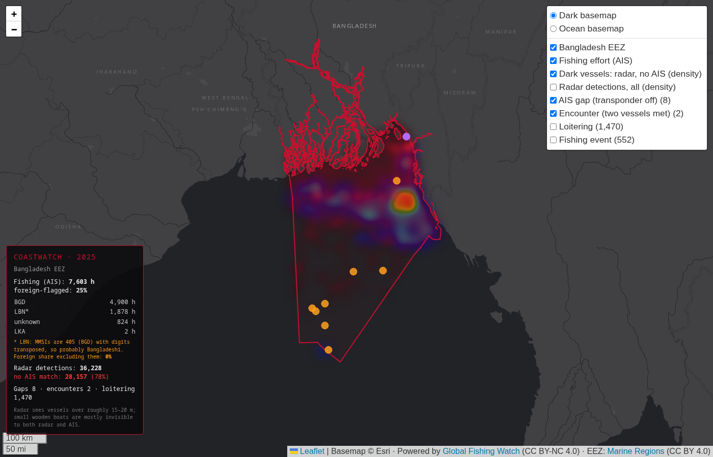

# Coastwatch

A maritime watch for the Bay of Bengal. Coastwatch maps fishing activity, **dark vessels** (seen by satellite radar but not broadcasting AIS), transponder gaps, ship-to-ship encounters and loitering inside Bangladesh's Exclusive Economic Zone.

> **Status: cheap test (step 1), first real run done.** The goal is to find out whether open data shows anything worth building on: foreign fishing in Bangladeshi waters, activity during fishing bans or inside marine protected areas. A dashboard comes later if it does.


*2025: AIS fishing effort (blue/green), dark-vessel density (red), AIS gaps (orange), an encounter (purple). Data: Global Fishing Watch.*

## First findings (2025)

- **"Lebanese" fishing is a typo.** 25% of AIS fishing hours in the EEZ were flagged Lebanese (LBN). Every one of those vessels transmits a `450…` MMSI: Bangladesh's country code `405` with the digits transposed. One broadcasts the name *BASUNDARA7*. Coastwatch flags this automatically. Excluding them, foreign-flagged AIS fishing is about 0%.
- **AIS shows very little fishing.** Only about 7,600 fishing hours for the whole EEZ in a year means most of the fleet isn't on AIS at all.
- **78% of radar detections have no AIS match,** but the densest hotspot is the Chattogram/Kutubdia outer anchorage, which is mostly merchant ships. The anchorages need masking before "dark" means anything.
- **8 AIS gaps and 2 encounters,** mostly far offshore toward the southern EEZ edge. Few enough to investigate one by one.

## How it works

```
Global Fishing Watch API ──┐
  AIS fishing effort        │
  Sentinel-1 radar detections (all / unmatched to AIS)
  events: fishing, AIS gaps, encounters, loitering
                            ├─→ data/processed/<year>/ ─→ summary + HTML map
Marine Regions WFS ─────────┘
  Bangladesh EEZ (MRGID 8481)
```

A radar detection with no matching AIS broadcast is a **dark vessel**. It doesn't prove wrongdoing (many vessels legally carry no AIS), but it is where to look.

## Usage

Requires [uv](https://docs.astral.sh/uv/) and a free [Global Fishing Watch API token](https://globalfishingwatch.org/our-apis/tokens/signup).

```sh
cp .env.example .env              # then paste your token as GFW_TOKEN=...
uv run coastwatch eez             # download the EEZ boundary
uv run coastwatch probe           # confirm API details (writes data/probe.json)
uv run coastwatch fetch --year 2025
uv run coastwatch summary --year 2025
uv run coastwatch map --year 2025 # → maps/coastwatch-2025.html
```

API responses are cached in `data/raw/gfw/`, so re-running uses no extra rate limit. The `probe` step exists because the API docs left some details ambiguous: the Events path, the encounters dataset name, whether EEZ region IDs are Marine Regions MRGIDs, and the SAR filter syntax. The probe asks the live API instead of guessing.

## Limits, stated honestly

- **Small boats are invisible.** Sentinel-1 radar reliably sees vessels over about 15–20 m. Most of Bangladesh's fleet is small wooden boats with no AIS, so this mainly covers industrial trawlers, foreign vessels and merchant shipping.
- **Coverage is periodic.** Radar passes come every few days, not continuously.
- **AIS can be faked or switched off,** and coverage far offshore depends on satellite AIS.
- **GFW's results are model output** (fishing classification, radar-to-AIS matching), not ground truth.

## Data and licences

- **Global Fishing Watch** data and API: [CC BY-NC 4.0](https://globalfishingwatch.org/our-apis/documentation#license), **non-commercial use only**. Powered by [Global Fishing Watch](https://globalfishingwatch.org).
- **EEZ boundary:** Flanders Marine Institute, Maritime Boundaries Geodatabase, [Marine Regions](https://www.marineregions.org), CC BY 4.0.
- **Basemaps:** © Esri.

## Roadmap

1. **Cheap test (done):** GFW data for one year, summary and map.
   - Next: mask the port anchorages, split by month and by ban periods, and investigate each AIS gap.
2. Own radar ship detection from Sentinel-1 scenes, compared against GFW's.
3. A coastal AIS receiver (RTL-SDR + AIS-catcher) for data no one else has.
4. Context layers: fishing-ban calendars, marine protected areas (Swatch of No Ground, Nijhum Dwip, Saint Martin's).
5. Dashboard (Postgres/PostGIS + API + React) with alerts.
